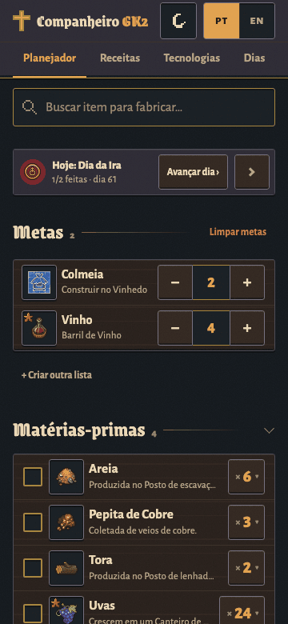
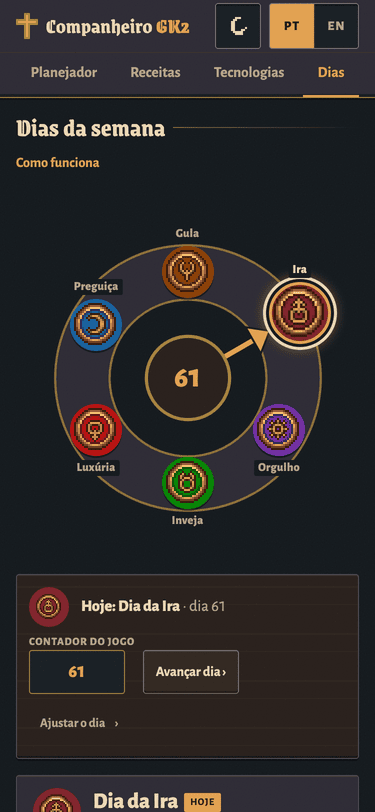

# GK2 Companion

**English** · [Português](README.pt-BR.md)

A crafting planner for **Graveyard Keeper 2**, in English and Brazilian Portuguese. Tell it what you want to build and it adds up every ingredient, from raw materials to the last step, grouped by station and in the right order, plus the technologies you still need to research.

[](CHANGELOG.md)
[](https://claude.com/claude-code)
[](#languages-and-themes)
[](LICENSE)

<p align="center">
  
  <br><sub>Search, add a goal, get the full shopping list and build order. (UI shown in Portuguese; one tap switches to English.)</sub>
</p>

## Try it

**Live app:** https://claude.ai/artifact/8hp57ZZTFoH6GyDQUdHZAn

- It is a single web page hosted as a [Claude Artifact](https://claude.ai). Works on phone and desktop.
- **Signed in to Claude:** your plan is saved to your account and opens the same on every device.
- **Not signed in:** everything still works; your plan is kept in that browser only.

**Or run it yourself** (no Claude account needed, no sync):

- Download the single file from the [latest release](https://github.com/hpizaia/GK2/releases/latest) and open it in a browser (works offline), or
- Put that file, renamed to `index.html`, on any static host (GitHub Pages, Netlify, a USB stick…). Everything is inline: no server, no API calls. (In the repository it is `dist/preview.html`; `dist/index.html` is the Artifact flavour of the same page: it has no `<html>`/`<head>` skeleton because the Artifact viewer adds its own.)

## Features

### Planner

| | |
|---|---|
|  | **Goals.** Search in English or Portuguese, accents optional (`swor` finds *Sword*). Set quantities with − / + (hold to repeat).<br><br>**Raw materials.** Everything to gather, buy or already have in a chest, with totals.<br><br>**Steps per station.** What to craft at each bench, how many runs, yield and leftovers. Follow top to bottom: no station depends on one further down.<br><br>**Perks** that change yields ("Cook II") recalculate the plan. **Copy list** as text. |
|  | **Alternative recipes.** When an item can be made several ways, pick one; silver/gold quality recipes are labelled.<br><br>**Groups** like "Bream or carp": choose which member you will use.<br><br>**Checklist** with a progress bar, per raw material and per step.<br><br>**Collapse** the Today panel, raw materials, steps and each station; the app remembers. |

<table>
<tr>
<td width="50%" align="center"><br><sub><b>"I have N of M"</b>: type how many you already own and the totals drop. "All" removes the item from the plan.</sub></td>
<td width="50%" align="center"><br><sub><b>Collapse</b> what you are done with. The state is kept per device.</sub></td>
</tr>
</table>

### Technologies still needed


Below the plan, the app lists every technology you have not researched yet that the plan requires (stations included), **in research order**, with the **sum of red, green and blue points**. Tick them off right there. Quests and perks the plan needs show under "Also needed".

<br clear="right">

### Recipes and Technologies tabs

| Recipes | Technologies |
|---|---|
|  |  |
| Every item in the game, with search and filters by category and station. Each item shows **all its recipes** (ingredients, station, technology, mastery, time, energy, silver/gold thresholds, by-products), how to obtain it and **"Used in"**. Add it to your goals or choose which recipe the planner uses. | All **226 technologies** in 6 branches, with cost, prerequisites, what each one unlocks and notes. Tick **"Researched"**: ticking one marks everything before it. Search by technology or by what it unlocks. |

### Days (the week wheel)

| | |
|---|---|
|  |  |

The game has a 6-day week shown as a wheel in the HUD. The **Days** tab reproduces it and lists what happens on each day (battles, trade ship, resurrection, town orders, mass…). Tap today's symbol, hit **"Today is this day"**, and a **Today** panel appears at the top of the planner. Tap **Next day** when you sleep in the game. **Calibrate** once with the in-game day counter ("day 60 = Pride") and from then on just type the number. Events that come only from guides, not from the game text, are marked *unconfirmed*.

### Languages and themes

| English | Light theme (parchment) | Desktop, three columns |
|---|---|---|
|  |  |  |

- **EN / PT** switches everything, item names included. Names come from the **official game files** in both languages; the few that do not are tagged *unofficial*, and you can edit any name (the edit is tagged *edited*).
- **Theme:** dark (night), light (parchment) or automatic.
- **Per-account sync:** goals, quantities, chosen recipes, "have", checks, edited names, researched techs, perks and the current day follow your Claude account. Two devices editing offline are merged field by field when they reconnect.
- **Update history** in the footer, with the version number.

## How it works

| Piece | What it does |
|---|---|
| **Recipe data** | Items, recipes, stations, technologies and alchemy from the public datasets API of the [wikily.gg](https://wikily.gg/graveyard-keeper-2) wiki (game 1.010), normalised by `scripts/fetch_dataset.py` + `scripts/build_dataset.py`. |
| **Official names** | pt-BR and English names exported from the player's own copy of the game (Steam, version 1.011) with `tools/exportar-textos/` (read-only, Windows). Fallbacks: the GK1 wiki and machine translation, always tagged. |
| **One HTML file** | `scripts/build.py` assembles `src/` (one JS module per feature, plain CSS, no framework, no dependencies) plus the data into a single page: `dist/index.html`. |
| **Icons** | The Artifact sandbox blocks external images, so every icon is packed into one embedded sprite (`scripts/make_sprite.py`). |
| **Sync** | The page declares the Claude Artifact `db` and `user` capabilities: each viewer gets a private document in the artifact's database. `localStorage` is the first source, so it opens instantly and works offline. |

Deeper docs (Portuguese): [architecture](docs/arquitetura.md), [data and translation layers](docs/dados.md), [game patch runbook](docs/atualizacao.md), [user guide](docs/guia-de-uso.md). Build options and schema (English): [`scripts/README-build.md`](scripts/README-build.md).

## Run locally, build and test

Requirements: **Python 3** (standard library only). **Node** is optional, for the JavaScript tests. Run everything from the project root; quote paths that contain spaces.

```sh
git clone https://github.com/hpizaia/GK2.git && cd GK2

python3 -I scripts/build.py           # data + page -> prototype/index.html, dist/index.html, dist/preview.html, CHANGELOG.md
python3 -I scripts/test_build.py      # build tests (fixtures + smoke test on the real data)
python3 -I scripts/test_techs.py      # technology tree tests
node scripts/test_calc.mjs            # planner maths, storage and sync tests

python3 -m http.server 8765 --bind 127.0.0.1 --directory prototype   # then open http://127.0.0.1:8765/
```

The repository already contains the built data and sprite, so a fresh clone builds without downloading anything.

| Folder | Contents |
|---|---|
| `src/` | Page source: `index.html` template, `css/`, `js/` (one `GK.*` module per file), `manifest.json` (build order) |
| `scripts/` | Build, validation, tests and data collection ([table](scripts/README.md)) |
| `tools/exportar-textos/` | Exporter for the official game texts (Windows) and `juntar_nomes.py` |
| `data/` | Build inputs and outputs: items, recipes, name layers, techs, days, sprite, changelog |
| `dist/`, `prototype/` | Generated pages. **Edit `src/`, never these.** |
| `docs/` | Documentation and the media used here |

## Duplicate it for yourself

Want your own copy (another language, your own artifact, a fork for a different game)? Follow **[docs/duplicate.md](docs/duplicate.md)** (Portuguese: [docs/duplicar.md](docs/duplicar.md)): requirements, refreshing the data, exporting official names from your own game, icons, building, publishing as a Claude Artifact or on any static host, adding a language and changing the theme.

Contributions and bug reports: [CONTRIBUTING.md](CONTRIBUTING.md).

## Credits and rights

<a id="data-and-licence"></a>

GK2 Companion is a **fan project**, made by **Hugo Pizaia**, a Brazilian fan of the game, to make playing it more fun. It is **free**, has **no ads**, sells nothing and makes no profit.

**Not affiliated with or endorsed by Lazy Bear Games or tinyBuild.**

| What | Owner | How it is used here |
|---|---|---|
| The game's art, icons, item names and texts (`data/game-texts/`, the name layers, `data/sprite.*`) | **Graveyard Keeper 2 © Lazy Bear Games / tinyBuild** | Used as fan content, with credit, only to show which item is which. Graveyard Keeper is their trademark. If they ask for anything to be removed or changed, it will be: [open an issue](https://github.com/hpizaia/GK2/issues). |
| Recipe and item data (`data/items.en.json`, `data/recipes.en.json` and everything derived from them) | [Graveyard Keeper 2 Wiki](https://wikily.gg/graveyard-keeper-2) on **Wikily**, © NX Software | No open licence. Permission for this fan use is being requested from the wiki (the icon files were also taken from the wiki's image server, so they are part of that request). Please do not reuse this data commercially. |
| Official Brazilian Portuguese and English names | Lazy Bear Games / tinyBuild | Read from the game's own text files (`tools/exportar-textos/`), not translated by this project. Fallbacks, always tagged in the app: the Graveyard Keeper (GK1) Fandom wiki and machine translation; game-key mapping from the GK2Thai mod's source CSV. |
| Code (`src/`, `scripts/`, `tools/`, `site/`, docs) | Hugo Pizaia | **[MIT](LICENSE), code only.** The licence file says explicitly what it does not cover: `data/`, the icons and sprite, the game texts, the screenshots and the generated pages that embed them (`dist/`, `prototype/`). Learn from it, fork it for another game, send fixes. |

**Made with AI.** The app was built with **[Claude Code](https://claude.com/claude-code)** (Anthropic). The code, design and translations were produced with the AI under Hugo's direction, using several agents in parallel (one per feature module, plus audit, QA and docs agents), and tested in the game. The game content itself is not generated: recipes come from the wiki, names from the game files, and every number is computed from those.

If you hold rights to anything here and want it changed or removed, please [open an issue](https://github.com/hpizaia/GK2/issues).
