<h1 align="center">Companheiro GK2</h1>

<p align="center">Um planejador de crafting gratuito para o <b>Graveyard Keeper 2</b>, feito por um fã: escolha o que quer fabricar e ele soma toda a matéria-prima, lista as etapas por estação na ordem certa e mostra as tecnologias que ainda faltam.</p>

<p align="center">
  <a href="https://claude.ai/artifact/8hp57ZZTFoH6GyDQUdHZAn"></a>
</p>

<p align="center"><a href="README.md">English</a> · <b>Português</b></p>

<p align="center">
  <a href="https://github.com/hpizaia/GK2/releases/latest"></a>
  <a href="#idiomas-e-temas"></a>
  <a href="LICENSE"></a>
  <a href="https://claude.com/claude-code"></a>
  
</p>

<p align="center">
  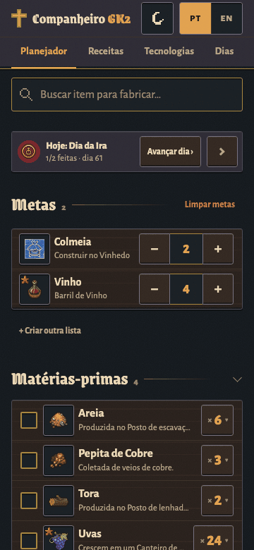
</p>

- **Grátis, sem anúncios e sem precisar de conta.** É só abrir o link, no celular ou no computador. Com login no Claude, o plano sincroniza entre os seus aparelhos; sem login, fica naquele navegador.
- **Privado.** O app não tem rastreamento nem estatísticas de uso; ninguém mais vê o seu plano.
- **Quer usar offline?** [Baixe o arquivo HTML único](https://github.com/hpizaia/GK2/releases/latest) e abra em qualquer navegador.
- **Nome errado, receita errada ou bug?** [Me avise aqui](https://github.com/hpizaia/GK2/issues/new/choose) (precisa de uma conta gratuita no GitHub). **Sem conta no GitHub?** Deixe um comentário no post do projeto no Reddit ou no [site do projeto](https://claude.ai/artifact/Bgn32T3eDPRFydxYoxgWTr).

Feito por **Hugo Pizaia**, jogador brasileiro e não programador, com o [Claude Code](https://claude.com/claude-code) (IA) sob a direção dele. As receitas vêm da [wiki wikily.gg](https://wikily.gg/graveyard-keeper-2) e os nomes dos itens vêm dos arquivos do próprio jogo: o conteúdo do jogo não é gerado por IA. Em inglês o app se chama *GK2 Companion*. Sem vínculo com a Lazy Bear Games nem com a tinyBuild, e sem endosso delas. [Créditos e direitos](#créditos-e-direitos).

## O que faz

### Planejador

#### Metas, matérias-primas e etapas

<p align="center">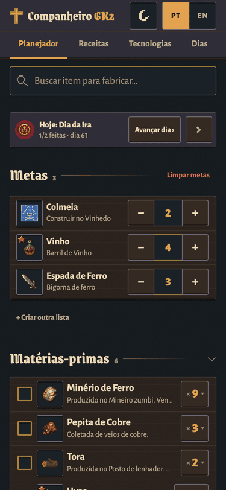</p>

- **Metas.** Busca em português ou inglês, sem precisar de acento (`caix` acha *Caixote*). Quantidade com − / + (segure para repetir).
- **Matérias-primas.** Tudo o que coletar, comprar ou já ter no baú, com o total.
- **Etapas por estação.** O que fabricar em cada bancada, quantas execuções, rendimento e sobra. Siga de cima para baixo: nenhuma estação depende de outra mais abaixo.
- **Vantagens** (perks) que mudam o rendimento ("Cozinheiro II") recalculam o plano.

#### Receitas alternativas e checklist

<p align="center">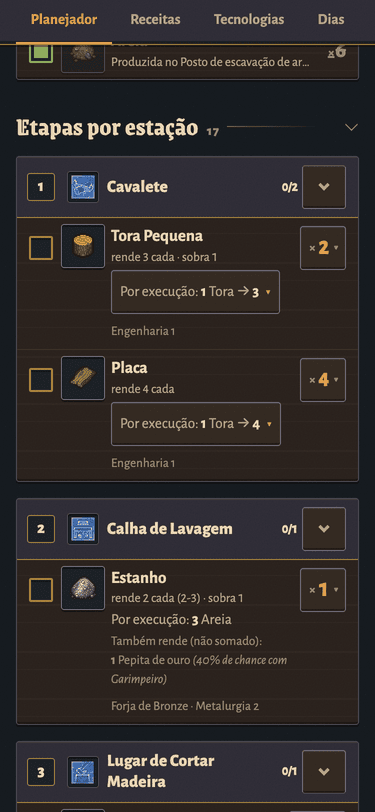</p>

- **Receitas alternativas.** Quando um item pode ser feito de mais de um jeito, escolha qual; receitas de qualidade prata/ouro vêm marcadas.
- **Grupos** como "Brema ou carpa": escolha qual item vai usar.
- **Checklist** com barra de progresso, por matéria-prima e por etapa.

#### "Tenho N de M"

<p align="center">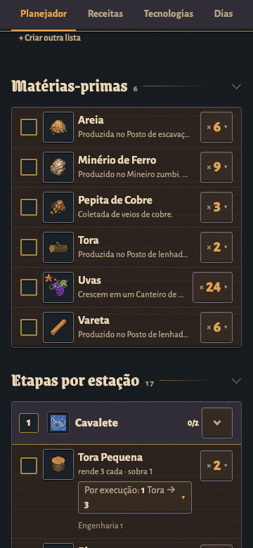</p>

Digite quantos você já tem e os totais caem. "Tudo" tira o item do plano.

#### Recolha o que já resolveu

<p align="center">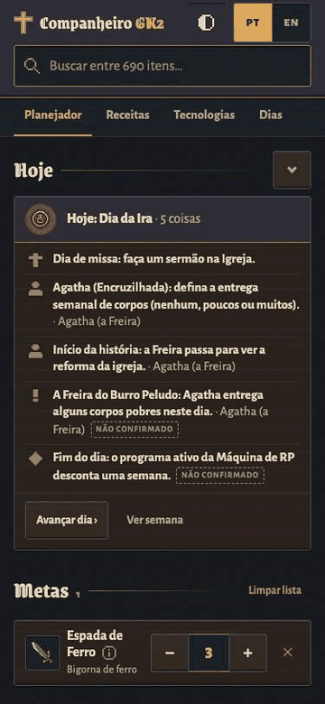</p>

Recolha o painel Hoje, as matérias-primas, as etapas e cada estação. O app lembra, em cada aparelho.

### Tecnologias que faltam

<p align="center">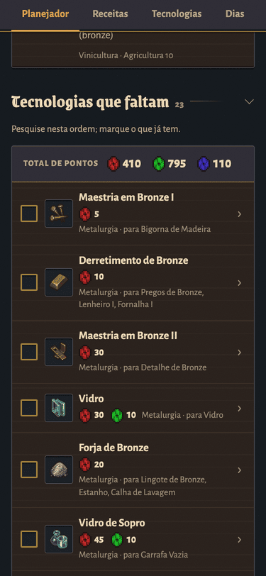</p>

Abaixo do plano, o app lista todas as tecnologias ainda não pesquisadas que o plano exige (estações incluídas), **na ordem de pesquisa**, com a **soma de pontos vermelhos, verdes e azuis**. Marque ali mesmo o que já pesquisou. Missões e vantagens exigidas aparecem em "Também precisa".

### Aba Receitas

<p align="center">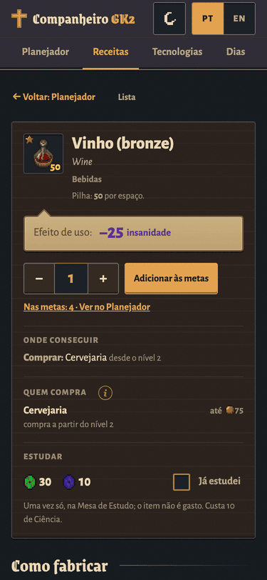</p>

Todos os itens do jogo, com busca e filtros por categoria e estação. Cada item mostra **todas as receitas** (ingredientes, estação, tecnologia, maestria, tempo, energia, limites de prata/ouro, subprodutos), como obter e **"Usado em"**. Adicione às metas ou escolha a receita que o Planejador usa.

### Aba Tecnologias

<p align="center">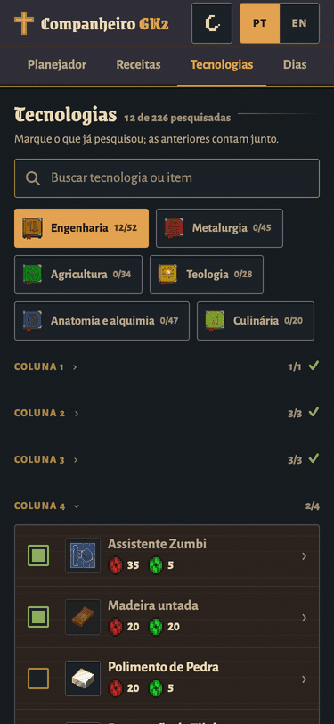</p>

As **226 tecnologias** nos 6 ramos, com custo, pré-requisitos, o que cada uma desbloqueia e notas. Marque **"Já pesquisei"**: marcar uma conta todas as anteriores. Busca pelo nome ou pelo que ela desbloqueia.

### Dias (a roda da semana)

<p align="center">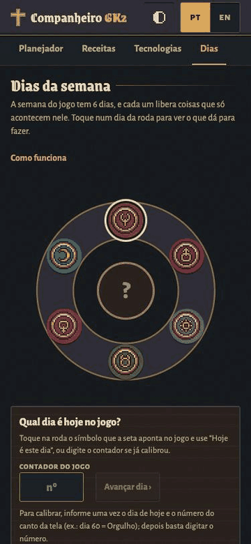</p>

O jogo tem uma semana de 6 dias, mostrada como uma roda no canto da tela. A aba **Dias** reproduz a roda e diz o que acontece em cada dia (batalhas, navio mercante, ressurreição, pedidos do povoado, missa…). Toque no símbolo de hoje, em **"Hoje é este dia"**, e o painel **Hoje** aparece no topo do Planejador. Toque em **Avançar dia** quando dormir no jogo. **Calibre** uma vez com o contador do jogo ("dia 60 = Orgulho") e depois é só digitar o número. Eventos que vêm só de guias, e não do texto do jogo, levam o selo *não confirmado*.

Cada evento de hoje tem uma caixinha de **"feito hoje"** (zera quando o dia muda e sincroniza entre aparelhos), o painel mostra uma prévia de **amanhã** para você preparar antes de dormir, e dá para deixar um **bilhete por dia da semana** ("levar 3 peixes para o Pescador") que volta sempre naquele dia. O botão **Letra grande** no rodapé deixa tudo mais fácil de ler de longe, e o app acompanha o tamanho de letra do celular.

### Idiomas e temas

<table align="center">
<tr>
<td align="center">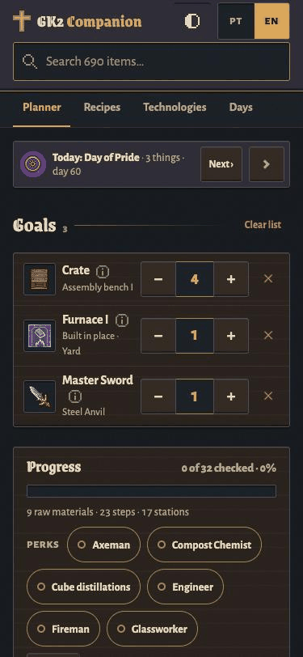<br><sub>Inglês</sub></td>
<td align="center">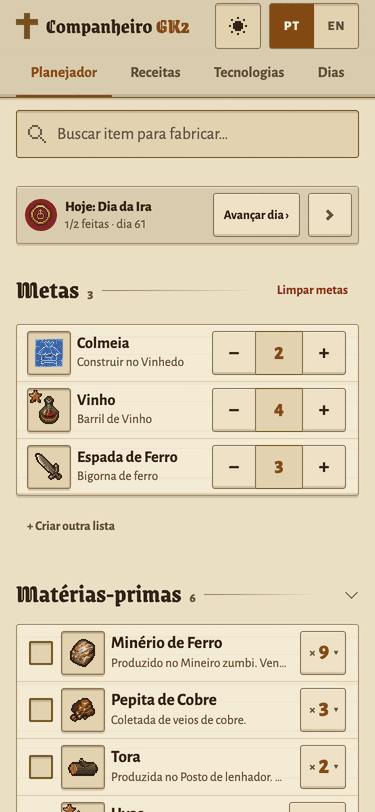<br><sub>Tema claro (pergaminho)</sub></td>
</tr>
</table>

- **PT / EN** troca tudo, inclusive os nomes dos itens. Os nomes vêm dos **arquivos oficiais do jogo** nos dois idiomas; os poucos que não vêm levam o selo *não oficial*, e você pode editar qualquer nome (a edição leva o selo *editado*).
- **Tema:** escuro (noite), claro (pergaminho) ou automático.
- **Sincronização por conta:** metas, quantidades, receitas escolhidas, "tenho", marcações, nomes editados, tecnologias pesquisadas, vantagens e o dia atual acompanham a sua conta do Claude. Dois aparelhos mexendo sem internet são mesclados campo a campo quando voltam a conectar.
- **Histórico de atualizações** no rodapé, com o número da versão.

No computador, o Planejador usa três colunas:

<p align="center">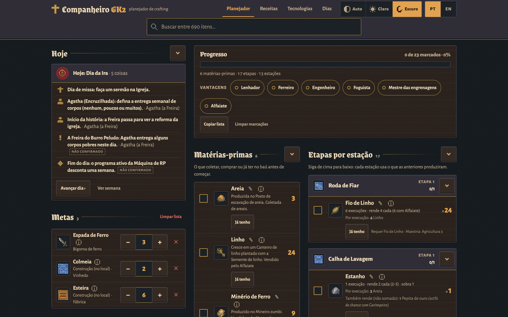</p>

## Como funciona

- **Dados de receitas.** Itens, receitas, estações, tecnologias e alquimia da API pública de datasets da wiki [wikily.gg](https://wikily.gg/graveyard-keeper-2) (jogo 1.010), normalizados por `scripts/fetch_dataset.py` + `scripts/build_dataset.py`.
- **Nomes oficiais.** Nomes em pt-BR e inglês exportados da cópia do próprio jogador (Steam, versão 1.011) com `tools/exportar-textos/` (só leitura, Windows). Reservas: a wiki do GK1 e tradução de máquina, sempre marcadas.
- **Um HTML só.** `scripts/build.py` junta `src/` (um módulo JS por função, CSS puro, sem framework, sem dependências) e os dados numa página única: `dist/index.html`.
- **Ícones.** O sandbox do Artifact bloqueia imagens externas, então todos os ícones vão num sprite embutido (`scripts/make_sprite.py`).
- **Sincronização.** A página declara as capacidades `db` e `user` do Claude Artifact: cada pessoa tem um documento privado no banco do artifact. O `localStorage` é a primeira fonte, então abre na hora e funciona offline.

Documentação detalhada: [arquitetura](docs/arquitetura.md), [dados e camadas de tradução](docs/dados.md), [roteiro de patch do jogo](docs/atualizacao.md), [guia de uso](docs/guia-de-uso.md), documentos de projeto (especificação, design, pendências, auditoria) em [`docs/projeto/`](docs/projeto/). Opções do build e schema (em inglês): [`scripts/README-build.md`](scripts/README-build.md).

## Rodar, montar e testar

Precisa de **Python 3** (só biblioteca padrão). **Node** é opcional, para os testes do JavaScript. Rode tudo da raiz do projeto e ponha entre aspas caminhos com espaço.

```sh
git clone https://github.com/hpizaia/GK2.git && cd GK2

# dados + página -> prototype/, dist/index.html, dist/preview.html, CHANGELOG.md
python3 -I scripts/build.py
# testes do build (fixtures + teste de fumaça nos dados reais)
python3 -I scripts/test_build.py
# testes da árvore de tecnologias
python3 -I scripts/test_techs.py
# testes do cálculo, do armazenamento e da sincronização
node scripts/test_calc.mjs

# depois abra http://127.0.0.1:8765/
python3 -m http.server 8765 --bind 127.0.0.1 --directory prototype
```

O repositório já traz os dados montados e o sprite, então um clone novo monta sem baixar nada.

**Hospede você mesmo** (sem conta do Claude, sem sincronização): ponha o arquivo da release (ou o `dist/preview.html`), renomeado para `index.html`, em qualquer hospedagem estática (GitHub Pages, Netlify, um pendrive…). Está tudo embutido, menos a folha de estilos do Google Fonts: sem servidor e sem chamadas de API. O `dist/index.html` é a versão para o Artifact da mesma página: não tem o esqueleto `<html>`/`<head>`, porque o visualizador do Artifact põe o dele.

| Pasta | O que tem |
|---|---|
| `src/` | Código da página: modelo `index.html`, `css/`, `js/` (um módulo `GK.*` por arquivo), `manifest.json` (ordem de montagem) |
| `scripts/` | Build, validação, testes e coleta de dados ([tabela](scripts/README.md)) |
| `tools/exportar-textos/` | Exportador dos textos oficiais do jogo (Windows) e `juntar_nomes.py` |
| `data/` | Entradas e saídas do build: itens, receitas, camadas de nomes, tecnologias, dias, sprite, changelog |
| `dist/`, `prototype/` | Páginas geradas. **Edite `src/`, nunca estas.** O `dist/preview.html` é o app inteiro num arquivo só |
| `site/` | A página de apresentação do projeto (outro Claude Artifact) |
| `docs/` | Documentação ([índice](docs/README.md)), as imagens usadas aqui e os documentos de projeto (`docs/projeto/`) |

## Faça a sua cópia

Quer a sua própria versão (outro idioma, o seu artifact, um fork para outro jogo)? Siga **[docs/duplicar.md](docs/duplicar.md)** (em inglês: [docs/duplicate.md](docs/duplicate.md)): requisitos, atualizar os dados, exportar os nomes oficiais do seu jogo, ícones, build, publicar como Claude Artifact ou em qualquer hospedagem estática, acrescentar um idioma e mudar o tema.

Contribuições e relatos de erro: [CONTRIBUTING.md](CONTRIBUTING.md#português).

## Créditos e direitos

<a id="dados-e-licença"></a>

O Companheiro GK2 é um **projeto de fã**, feito por **Hugo Pizaia**, um fã brasileiro do jogo, para deixar a jogatina mais divertida. É **gratuito**, **sem anúncios**, não vende nada e não tem fins lucrativos.

**Sem vínculo com a Lazy Bear Games nem com a tinyBuild, e sem endosso delas.**

- **Arte, ícones, nomes de itens e textos do jogo** (`data/game-texts/`, as camadas de nomes, `data/sprite.*`): **Graveyard Keeper 2 © Lazy Bear Games / tinyBuild.** Usados como conteúdo de fã, com crédito, só para mostrar qual item é qual. Graveyard Keeper é marca deles. Se pedirem para tirar ou mudar algo, sai ou muda: [abra uma issue](https://github.com/hpizaia/GK2/issues).
- **Dados de receitas e itens** (`data/items.en.json`, `data/recipes.en.json` e tudo o que deriva deles): [Graveyard Keeper 2 Wiki](https://wikily.gg/graveyard-keeper-2) no **Wikily**, © NX Software. Sem licença aberta. Está sendo pedida autorização à wiki para este uso de fã (os arquivos dos ícones também vieram do servidor de imagens da wiki, então entram no mesmo pedido). Não reaproveite estes dados comercialmente.
- **Nomes oficiais em português do Brasil e em inglês:** Lazy Bear Games / tinyBuild. Lidos dos próprios arquivos de texto do jogo (`tools/exportar-textos/`), não traduzidos por este projeto. Reservas, sempre marcadas no app: a wiki Fandom do Graveyard Keeper (GK1) e tradução de máquina; ligação com as chaves do jogo a partir do CSV do mod GK2Thai.
- **Código** (`src/`, `scripts/`, `tools/`, `site/`, docs): Hugo Pizaia. **[MIT](LICENSE), só o código.** O arquivo de licença diz explicitamente o que ele não cobre: `data/`, os ícones e o sprite, os textos do jogo, as capturas e as páginas geradas que embutem tudo isso (`dist/`, `prototype/`). Aprenda com ele, faça um fork para outro jogo, mande correções.

**Feito com IA.** O app foi feito com o **[Claude Code](https://claude.com/claude-code)** (Anthropic). O código, o design e as traduções foram produzidos com a IA sob a direção do Hugo, usando vários agentes em paralelo (um por módulo, mais agentes de auditoria, QA e documentação), e testados no jogo. O conteúdo do jogo não é gerado: as receitas vêm da wiki, os nomes vêm dos arquivos do jogo, e todos os números são calculados a partir deles.

Se você detém direitos sobre algo daqui e quer que mude ou saia, [abra uma issue](https://github.com/hpizaia/GK2/issues).
