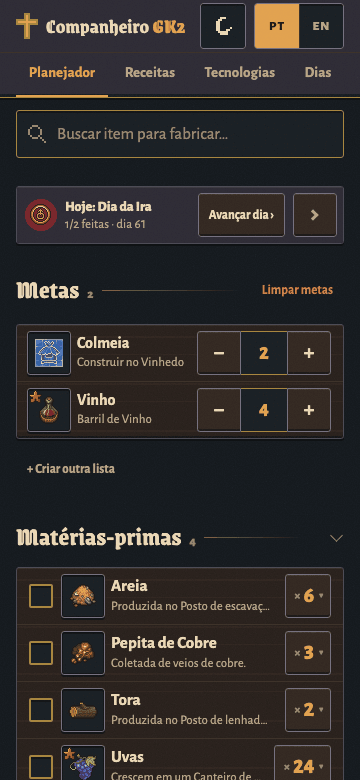
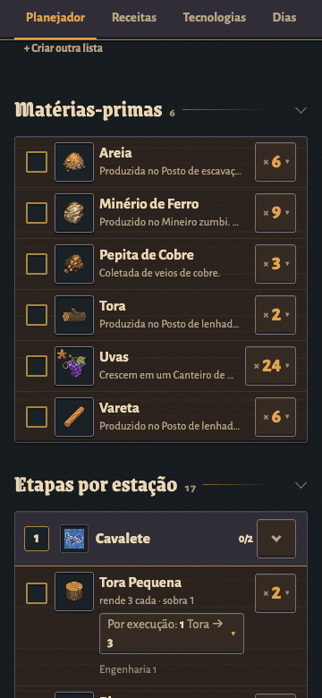
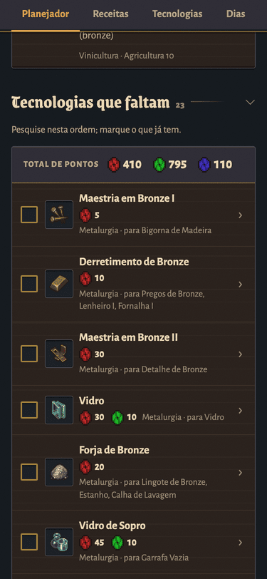
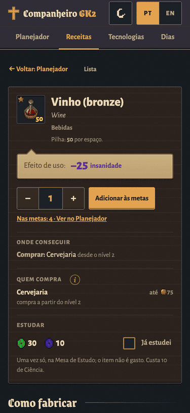
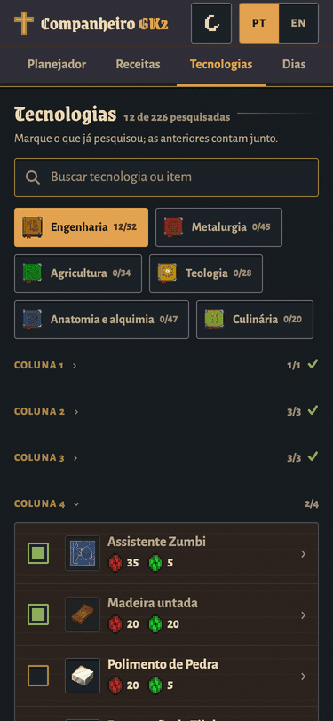
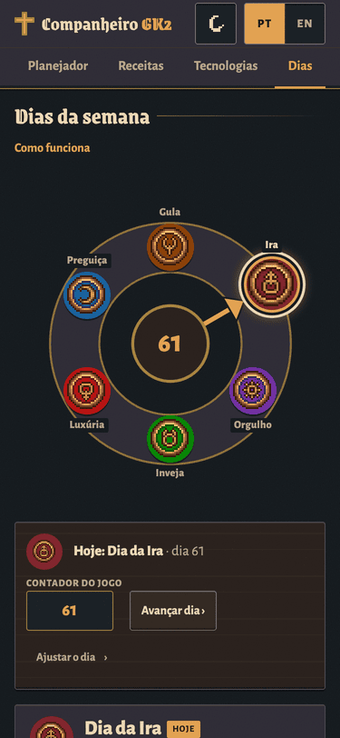
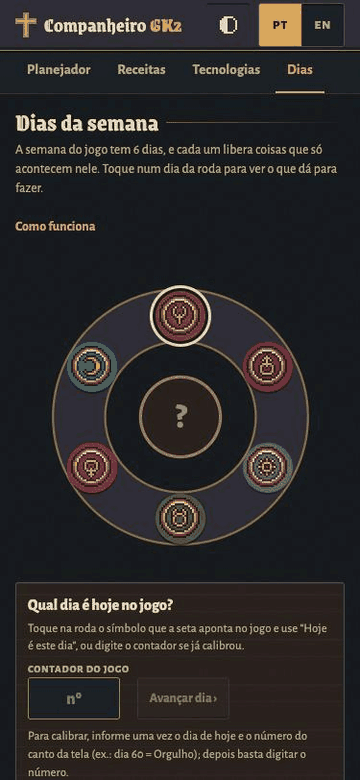

# Guia de uso do Companheiro GK2

Para quem joga. O Companheiro diz tudo o que você precisa juntar e fabricar para chegar às suas metas no Graveyard Keeper 2. Abra pelo link que o Hugo compartilhou (o artifact no claude.ai). Funciona no celular e no computador.

No topo ficam as abas **Planejador**, **Receitas** e **Tecnologias**, o botão de **tema** e o seletor **PT / EN**.

## Planejador

### Adicionar metas
1. Na busca, digite o nome do que quer fabricar, em português ou inglês. Não precisa de acento nem do nome inteiro: "caix" acha "Caixote".
2. Toque no resultado (ou em "+ Adicionar"). Ele entra em **Metas** com quantidade 1.
3. Ajuste a quantidade com − e +. **Segure** o botão para a conta correr sozinha, ou digite o número.
4. Com quantidade 1, o − vira um ✕ que tira a meta; o aviso "Saiu das metas" tem **Desfazer**. "Limpar metas" tira todas (pede confirmação).

Na primeira visita aparece uma lista de exemplo. Mude as quantidades ou limpe a lista para começar a sua.

Itens ocultos (que a wiki esconde, que não existem na versão atual do jogo ou que não são itens de verdade) só aparecem se você tocar em "Mostrar itens ocultos".

### Ler o plano
- **Matérias-primas:** o que coletar, comprar ou já ter no baú antes de começar, com o total de cada uma.
- **Etapas por estação:** o que fabricar em cada bancada, forno etc., com quantas vezes rodar a receita ("3 execuções"), quanto cada uma rende e o que sobra. **Siga de cima para baixo:** nenhuma estação depende de outra que aparece mais abaixo. Se uma estação precisa ser usada de novo depois de outra, ela aparece duas vezes, marcada "de novo".
- Cada etapa diz também a tecnologia, a maestria ou a extensão que a receita exige.

### "Tenho tudo" e "tenho N de M"

- **Matéria-prima:** marcar a caixinha quer dizer "já tenho tudo". O item vai para "Você já tem" e aparece um aviso com **Desfazer**. Desmarcar devolve o item à lista.
- **Só uma parte:** toque na quantidade (**× 98 ▾**), na matéria-prima ou na etapa. Abre um campo "Tenho [ ] de M": digite quantos você já tem e toque em **OK**; o plano desconta só esses. **✕** fecha; depois, **Limpar** esquece o número.
- **Etapa:** no mesmo campo, **Tudo** tira o item da conta (deixa de ser fabricado e vai para "Você já tem" nas matérias-primas; desmarcar a caixinha ali volta a fabricá-lo).
- A marcação acompanha a quantidade: um item marcado quando o plano pedia 3 volta para a lista se o plano passar a pedir 10.

### Grupos ("Brema ou carpa")
Algumas receitas aceitam qualquer item de um grupo, como "Brema ou carpa" ou "Qualquer jornal". No item do grupo aparece **Usar:**, onde você escolhe qual vai usar. O plano passa a contar esse item. "Qualquer um" volta ao grupo. A escolha fica guardada para os próximos planos.

### Receitas alternativas
Quando um item pode ser feito de mais de um jeito, a etapa mostra **Receita** com um seletor. Cada opção mostra os ingredientes, a estação e, nas receitas de qualidade, "prata" ou "ouro" (a de ouro pede o ingrediente de ouro). A escolha vale para esse item em todos os planos. A tela Receitas também deixa escolher.

### Progresso e vantagens
- Marque a caixinha de cada matéria-prima que você já tem toda e de cada etapa feita. A barra de progresso acompanha. Para desmarcar, toque de novo na caixinha.
- Só a caixinha marca. Tocar no nome não marca nada.
- **Vantagens:** as vantagens (perks) do jogo que mudam quantidades neste plano, como "Cozinheiro II". Ligue as que você já tem: o plano recalcula rendimentos e ingredientes.

### Tecnologias que faltam

Abaixo do plano aparece **Tecnologias que faltam**: o que você ainda precisa pesquisar para fabricar tudo (as estações também contam), na ordem de pesquisa, com o **total de pontos** vermelhos, verdes e azuis. Marque ali mesmo o que já pesquisou. Missões e vantagens que o plano exige aparecem em "Também precisa". Quando não falta nada, o painel some.

## Receitas

- Todos os itens do jogo. Use a busca ou os **Filtros** por categoria e estação.
- Toque num item para ver **Como fabricar** (cada receita, com ingredientes, estação, tecnologia, maestria, tempo, energia e subprodutos), **Como obter** e **Usado em** (o que consome esse item; toque para navegar).
- **Adicionar às metas**, com a quantidade.
- **Usar esta receita no planejador** troca a receita que o Planejador usa. "Voltar à receita padrão" desfaz.
- "← Voltar à lista" volta. (O gesto de voltar do celular ainda não volta para a lista.)

## Tecnologias

- As 226 tecnologias, por ramo (Engenharia, Metalurgia, Agricultura, Teologia, Anatomia e alquimia, Culinária). Cada ramo mostra quantas você já pesquisou.
- Marque **Já pesquisei** no que já tem no jogo. Marcar uma tecnologia conta todas as anteriores como pesquisadas. Para desmarcar uma anterior, desmarque a que veio depois.
- Toque numa tecnologia para ver custo, pré-requisitos (com "Marcar pré-requisitos como pesquisados"), o que ela desbloqueia, o que vem depois e notas (por exemplo, se é dada pela história ou exige reputação).
- A busca acha pelo nome da tecnologia ou pelo que ela desbloqueia.
- "Limpar pesquisadas" desmarca todas (pede confirmação).

## Nomes
- Os nomes vêm dos arquivos oficiais do jogo. Os poucos que não vêm levam o selo **não oficial**.
- Para corrigir um nome **não oficial**, abra o item em **Receitas** e toque no selo **não oficial ✎** ao lado do nome. Digite o nome certo e toque em **Salvar**. O nome ganha o selo **editado** e vale em todas as telas, no idioma em uso. Para desfazer, toque no selo **editado** e em **Voltar ao nome original**.
- Com o campo aberto, **Exportar nomes editados** copia suas correções em JSON. Mande para o Hugo, para entrarem na próxima versão.

## Idioma e tema
- **PT / EN** troca o idioma de tudo, inclusive dos nomes dos itens. A busca aceita os dois idiomas sempre.
- O botão de tema alterna entre **Auto** (segue o celular ou computador), **Claro** (pergaminho) e **Escuro** (noite).

## Sincronização
Se você abre a página com a sua conta do Claude, o plano fica salvo nela e abre igual no celular e no computador: metas, quantidades, receitas escolhidas, "tenho", marcações, nomes editados, tecnologias pesquisadas, vantagens e grupos. Cada pessoa tem o próprio plano. Ninguém vê o seu.

O **chip no rodapé** diz como está:
- **Sincronizado há N min:** está tudo salvo na conta.
- **Sincronizando…** ou **Conectando à sua conta…:** está salvando ou buscando.
- **Não sincronizado:** não deu para salvar agora. O plano continua salvo neste aparelho, e a página tenta de novo.
- **Só neste aparelho:** sem conta. O plano fica só neste navegador.

Se você mexer no celular e no computador ao mesmo tempo, sem internet, a página junta as duas versões quando voltar a conectar: nada some sem aviso.

**Sem login:** tudo funciona, mas o plano fica só naquele navegador. Se depois alguém entrar com uma conta nesse mesmo navegador, o plano feito sem login vai para essa conta (uma vez só). Num computador compartilhado, entre com a sua conta antes de montar o plano.

## Versão e histórico
O rodapé mostra a versão (por exemplo "Companheiro GK2 v1.2.0") e o link **Histórico de atualizações**, com o que mudou em cada versão.

## Avisos
- Quantidades são as de base da wiki, com os bônus das vantagens que você ligar. Plantio tem rendimento variável e não entra na conta.
- Alquimia mostra uma mistura de exemplo: qualquer combinação com as mesmas runas serve.
- Os dados de receitas vêm da wiki wikily.gg (jogo 1.010). Depois de um patch do jogo, pode levar um tempo até o Companheiro ser atualizado.

## Dias (a roda da semana)

 

O jogo tem uma semana de 6 dias, cada um com um símbolo na roda do canto da tela: Gula, Preguiça, Luxúria, Inveja, Orgulho e Ira (Ganância não tem dia). A aba **Dias** mostra a mesma roda e, para cada dia, o que acontece: batalhas da cidade na Preguiça, navio mercante na Luxúria, ressurreição na Inveja, pedidos da cidade no Orgulho, missa na Ira, carga da Máquina de RP na Gula.

- **Marcar o dia de hoje:** toque no símbolo que você vê no jogo e depois em "Hoje é este dia". O painel **Hoje** aparece no topo do Planejador com a lista do dia.
- **Avançar dia:** quando dormir no jogo, toque em "Avançar dia" no painel Hoje ou na aba Dias.
- **Calibrar pelo contador:** o jogo mostra o número do dia no canto (por exemplo, 60). Informe uma vez o número e o dia ("dia 60 = Orgulho"); daí em diante basta digitar o número novo que o app descobre o dia da semana. "Recalibrar" apaga essa referência.
- **"Não confirmado":** eventos que vieram só de guias, e não do texto do jogo, levam esse selo. Se você perceber um erro jogando, me avise que corrijo.
- **Feito hoje:** cada evento do dia tem uma caixinha. Marque o que já fez; as marcações zeram sozinhas quando o dia muda.
- **Amanhã:** abaixo dos eventos, o painel Hoje mostra o dia seguinte e o que preparar antes de dormir no jogo. Toque para abrir aquele dia na aba Dias.
- **Bilhete do dia:** um recado curto por dia da semana ("levar 3 peixes para o Pescador"), que volta sempre naquele dia. Dá para escrever no painel Hoje ou na aba Dias.
- **Letra grande:** o botão "Letra grande" no rodapé aumenta o texto do app, para olhar de longe enquanto joga. O app também acompanha o tamanho de letra do celular.
- O dia atual, a calibração, as marcações e os bilhetes sincronizam com a sua conta, como o resto do progresso.
